# 灵境深索 · 紫微斗数与 AI 研习平台

中文介绍 | [English](README.en.md)

> 以命盘为起点，连接传统斗数知识、人生经历与 AI 对话。

**灵境深索**是一款将紫微斗数排盘计算、专业知识字典与大模型解读相结合的应用。系统根据用户的问题识别分析对象，由程序计算对应命盘，再结合流派规则、领域知识和个人经历组织 AI 解读。围绕这条分析主线，项目集成命例管理、交互排盘、人生履历与知识学习，支持从观察盘面到持续追问的完整研习过程。

项目由 **yanch** 开发，适用于紫微斗数爱好者、传统文化学习者，以及需要长期整理命例和开展案例研究的用户。

## 在线演示

- **演示地址**：[http://test.ychos.cn:7707/](http://test.ychos.cn:7707/)
- **账号**：`yanch`
- **密码**：`123456`

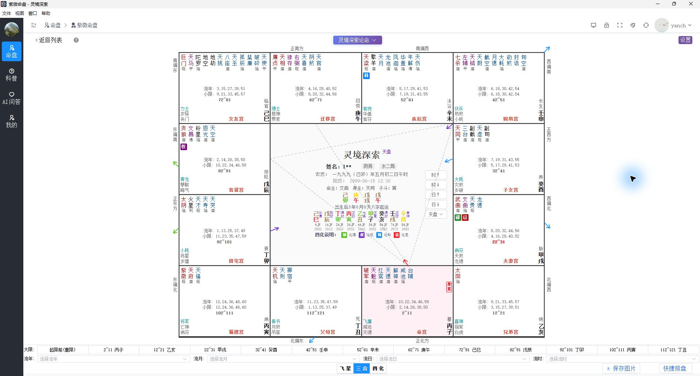

## 项目特色

### 程序排盘计算，AI 结合专业数据解读

排盘及大限、流年等动态盘计算由项目自身的程序完成，计算结果作为结构化数据参与提示词构建。AI 围绕实际的星曜、宫位与四化信息展开解释，用户也能在可视化盘面中对照相关信息。

### 三合与四化分别组织分析逻辑

项目为三合与四化构建不同的提示词与数据组织逻辑：三合关注星曜组合、庙旺落陷、三方四正等信息；四化结合生年四化、来因宫、向心与离心自化、宫干飞宫、法象回归生年等关系，并接入相应的象义字典。三合盘、飞星盘、四化盘为这些专业关系提供直观的观察入口。

### 理解问题后，动态准备分析内容

对话服务先区分排盘、科普、命盘分析和追问等意图，再提取相关的年份、大限、宫位及流派参数。例如，询问某一年的事业时，系统可据此计算对应流年盘，并组织相关宫位和四化数据；继续追问时，可继承上轮分析参数。缺少必要信息时，路由流程支持向用户补充询问。

### 让人生履历参与个性化分析

“灵境专属命盘”将用户自述经历纳入分析背景。系统可依据问题涉及的宫位筛选相关履历类别，提炼关键事件摘要，再与命盘信息一并提供给 AI。例如，讨论事业宫位时可选择关联的事业经历，让交流围绕用户提供的具体背景展开。

### 科普问答结合知识库检索

科普问答路径接入紫微斗数知识库的向量检索，将检索到的资料作为回答上下文。配合星曜、宫位及四化等专业字典，项目可以持续积累和维护领域知识，为知识讲解与命盘分析提供资料基础。

### 工程侧支持专业数据沉淀

项目还包含专业数据标注与批量处理模块，可围绕生年四化、飞宫四化、大限叠宫、法象回归生年等主题准备样本，保存分析说明与结论，并导出 JSONL 数据，为后续训练与验证准备材料。

以上特色依据当前项目代码整理；桌面端与移动端界面见下方截图，具体开放范围以当前版本为准。

## 桌面端核心功能与界面

### 1. 命例管理

集中维护命主资料，展示姓名、性别、公历与农历出生信息、分组和备注。支持按姓名或备注搜索，按家人、朋友、同学、同事、客户等分组查看，并提供命例导入、导出及排盘入口，方便积累和查找研究案例。

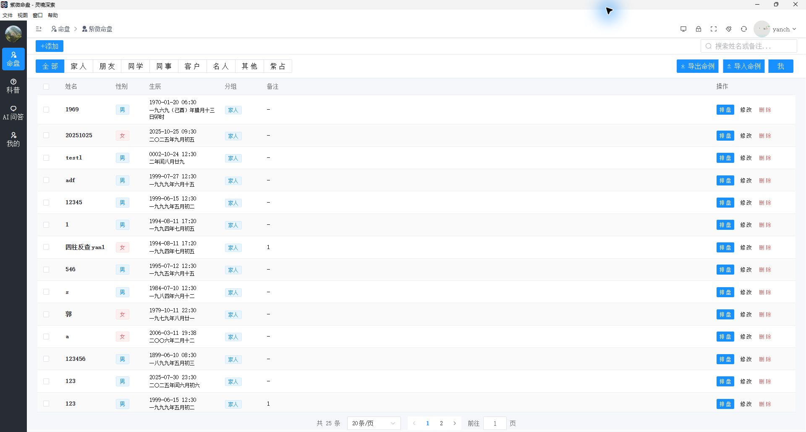

### 2. 交互排盘与多视角观察

支持公历、农历输入及四柱反查，提供三合、飞星、四化三种命盘视图。用户可以查看十二宫与星曜分布，结合大限和流年、流月、流日、流时选择控件观察不同时间层次的盘面，并将命盘保存为图片。

三合盘展示见本文开头；以下分别为飞星盘与四化盘。

**飞星盘**：展示主要星曜、四化标记和大限宫位信息，便于结合宫位关系进行观察。

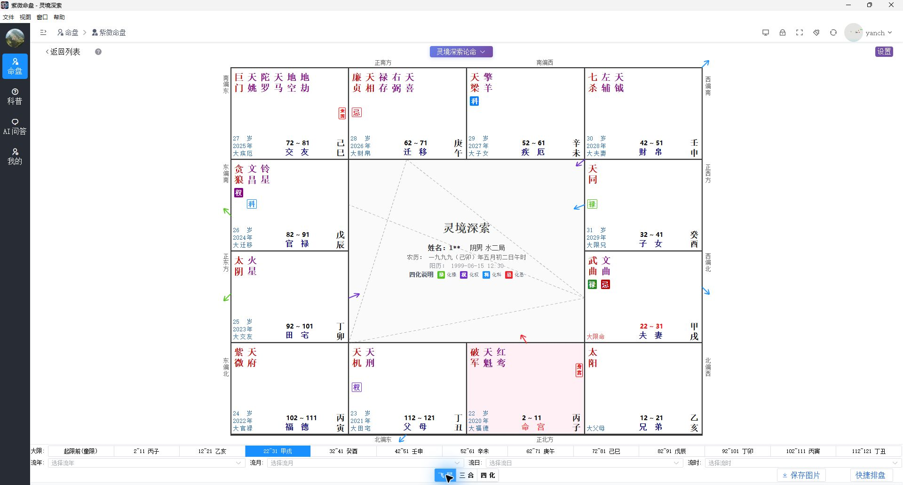

**四化盘**：通过不同颜色的标记与连线呈现四化关系，帮助用户追踪宫位之间的联系。

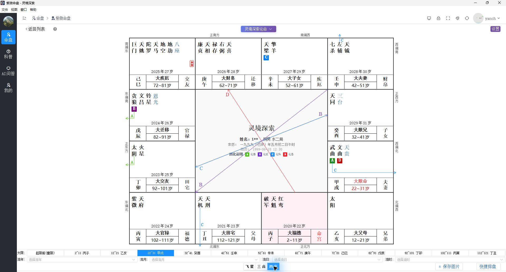

### 3. AI 辅助解析

“灵境深索论命”提供原局、大限、流年解析入口，可按宫位选择分析对象，也可进入本命盘解析。后端提供流式输出接口，使分析内容能够逐步呈现。

当前实机菜单中，**流月、流日、流时的 AI 解析标为“暂未开放”**；这些解析入口与命盘上的时间选择控件属于不同功能。

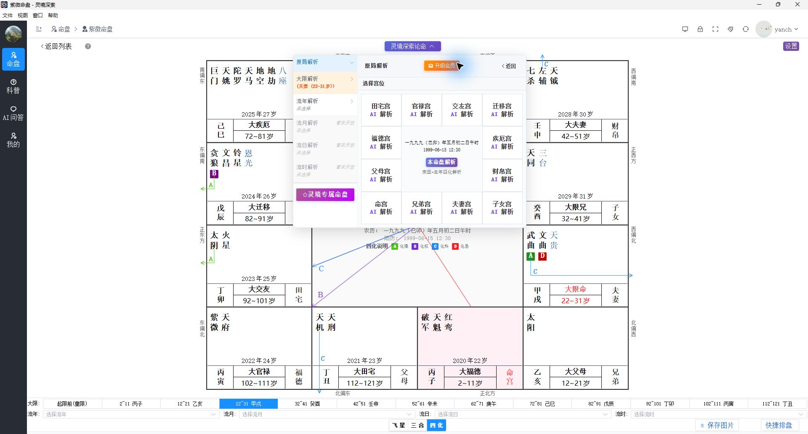

### 4. 灵境专属命盘与人生履历

用户可以按学业转折、事业变迁、感情经历、家庭变故等类别记录人生经历，并补充自定义内容。项目支持将履历作为 AI 对话的背景信息，使交流能够结合命盘和用户提供的实际经历展开。

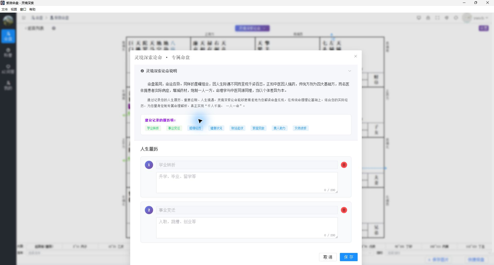

### 5. AI 问答

内置紫微斗数 AI 助手，支持直接咨询基础知识，也支持先选择命盘再展开相关讨论。提供新建对话、历史会话、命盘切换与查看、履历入口和多种界面主题，便于围绕同一研究对象持续交流。

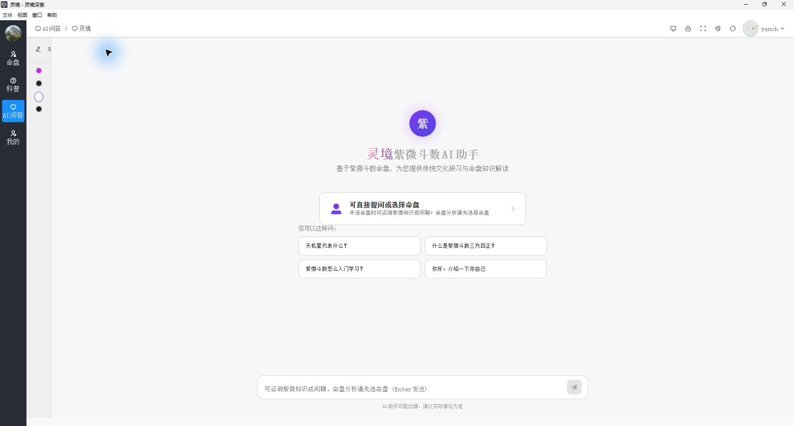

### 6. 知识学习与科普

科普模块设置软件使用、斗数术语、名人堂、进阶之路等栏目，支持分类浏览与内容搜索，让用户能够在排盘和问答之外查阅相关资料。

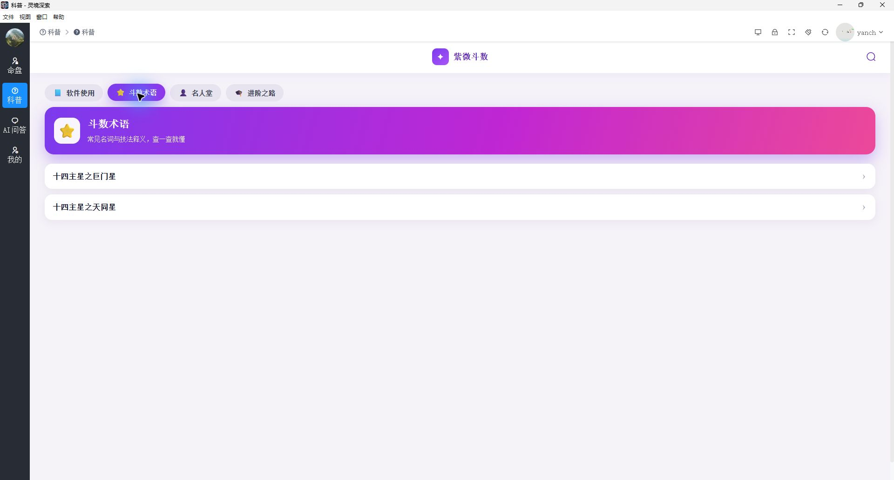

## 移动端 · 随身排盘与 AI 研习

灵境深索移动端将命盘观察、命例管理、AI 解析与知识学习带到手机上。通过底部导航切换命盘、灵境对话、帮助和个人中心，可以从选择命例、查看盘面，到阅读解析和继续追问，在手机上完成连续的研习过程。以下使用项目提供的 iOS 界面截图。

### 1. 手机查看三合盘与四化盘

竖屏界面保留完整十二宫布局、星曜信息、四化标记及关系连线，下方提供大限、流年等时间选择区域，并设置飞星、三合、四化视图切换与快捷排盘入口，方便随时对照盘面研究。

| 三合盘 | 四化盘 |
| --- | --- |
| 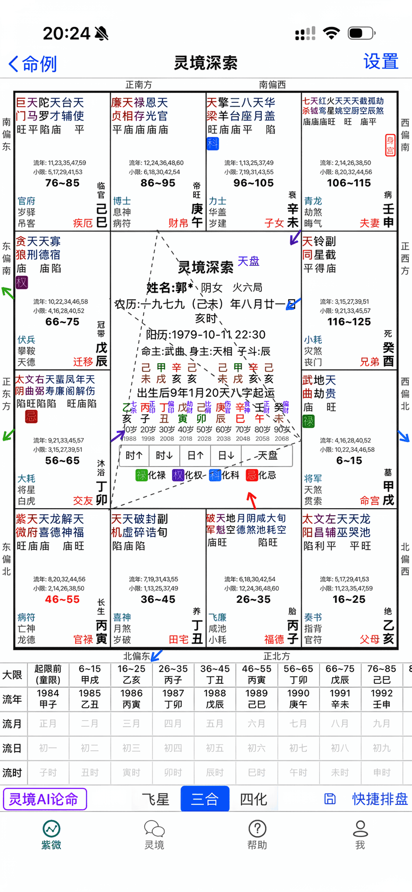 | 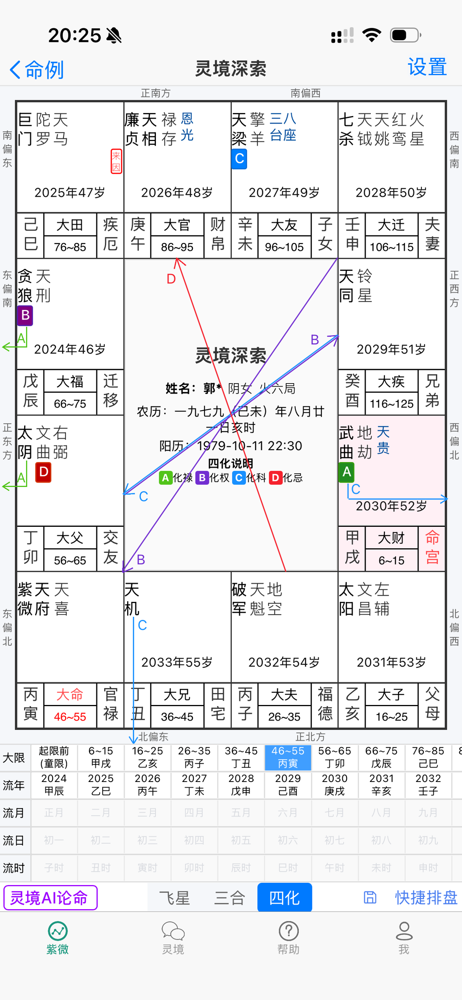 |

### 2. 从具体年份与宫位进入解析

“灵境 AI 论命”按原局、大限、流年组织解析入口，可选择年份与目标宫位。解析内容在盘面上方的阅读面板逐步呈现，提供停止解析与分享结果入口，便于在观察命盘时查看对应解读。

| 解析对象选择 | 解析内容阅读 |
| --- | --- |
| 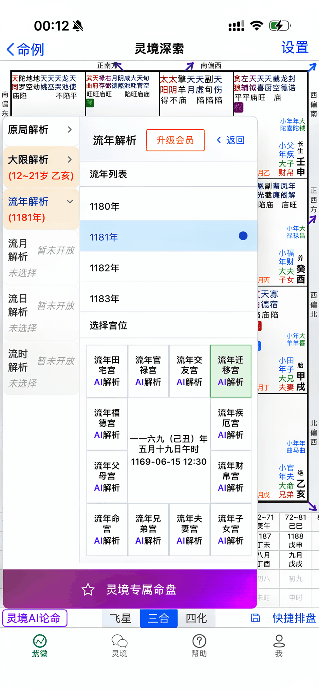 | 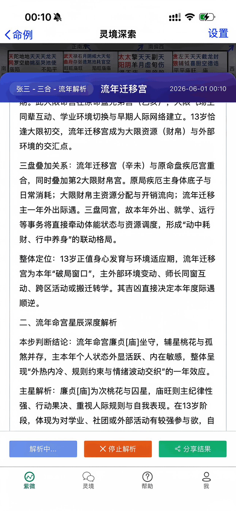 |

### 3. 围绕所选命盘持续问答

“灵境”对话页支持选择命盘、进入历史会话与新建对话。选定研究对象后，可以围绕宫位、星曜组合与个人问题继续提问；截图展示了问题识别说明与命盘概要，让用户能够对照本轮讨论的分析对象。

| 对话入口 | 命盘问答 |
| --- | --- |
| 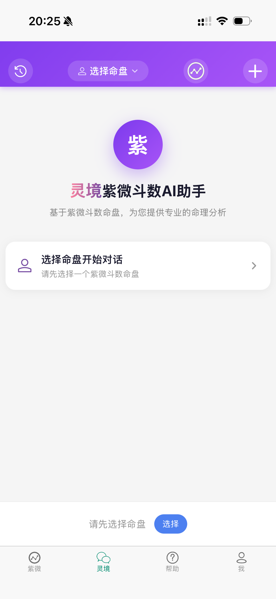 | 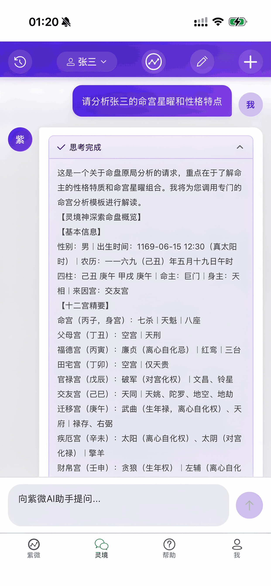 |

### 4. 知识检索与学习资料

基础知识问答可结合检索到的紫微斗数资料展开，截图中展示了相关知识片段。帮助中心则按软件使用、斗数术语、名人堂等栏目组织文章，支持搜索，方便边看盘边查阅概念与操作说明。

| 知识问答与检索片段 | 帮助中心 |
| --- | --- |
| 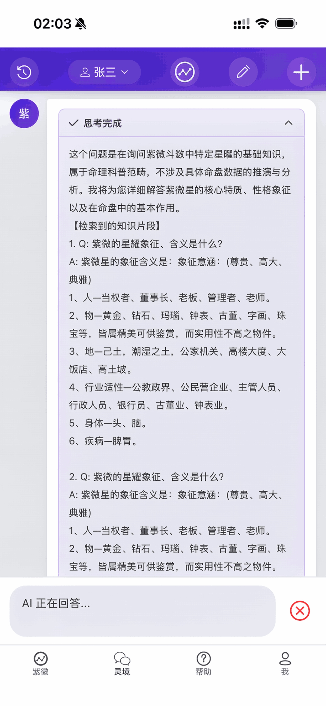 | 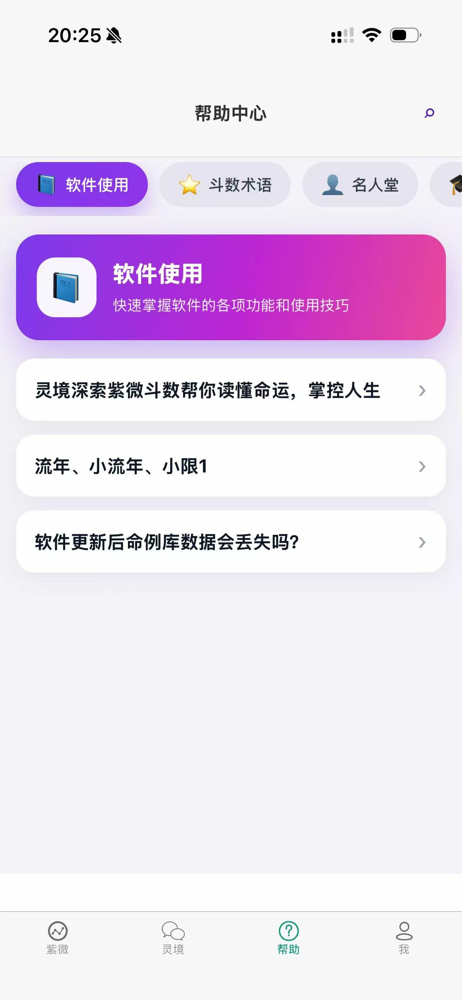 |

### 5. 命例管理与个人中心

命例列表支持按姓名或备注搜索、按分组筛选，并提供添加、修改、删除和排盘入口。个人中心集中展示会员等级、状态、有效期及邀请信息，方便查看账号与服务情况。

| 命例列表 | 个人中心 |
| --- | --- |
| 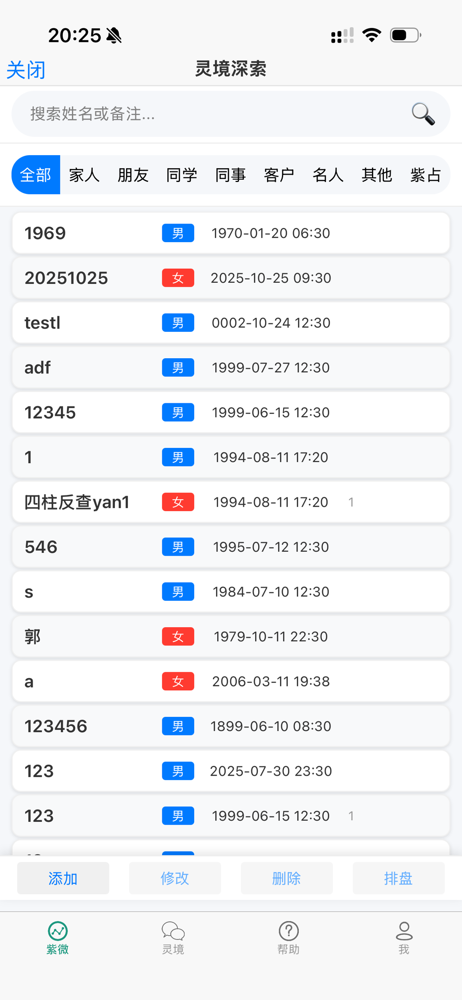 | 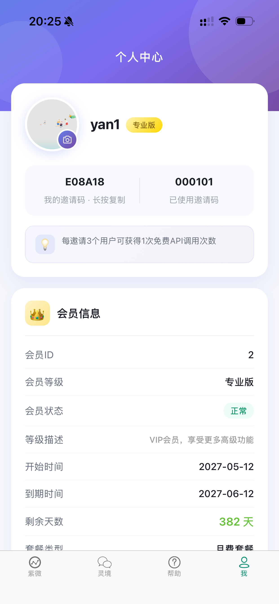 |

## 典型使用流程

1. 新建或导入命例，整理出生资料、分组与备注。
2. 打开命盘，切换三合、飞星或四化视图，查看宫位和时间层次。
3. 按需补充人生履历，为后续交流提供背景。
4. 选择 AI 解析入口，或进入 AI 问答围绕命盘继续提问。
5. 结合科普资料复习概念，保存命盘图片并积累研究案例。

## 技术实现概览

| 层次 | 主要技术与职责 |
| --- | --- |
| 界面与桌面端 | Vue 3、Element Plus、Electron；承载命例管理、命盘可视化和 AI 对话界面 |
| 移动端 | uni-app、Vue 3；提供手机端命盘、AI 对话、帮助及个人中心页面 |
| 业务后端 | Java、Spring Boot、MyBatis-Plus；提供命例、履历、会话和分析接口 |
| AI 服务 | Lemon AI、Spring AI；封装模型调用及分析服务，通过 SSE 提供流式响应 |
| 领域数据 | 紫微斗数星曜、宫位、四化等字典，以及提示词、模型数据管理相关模块 |

## 项目信息

- **项目名称**：灵境深索
- **开发者**：yanch
- **联系方式**：15071015744